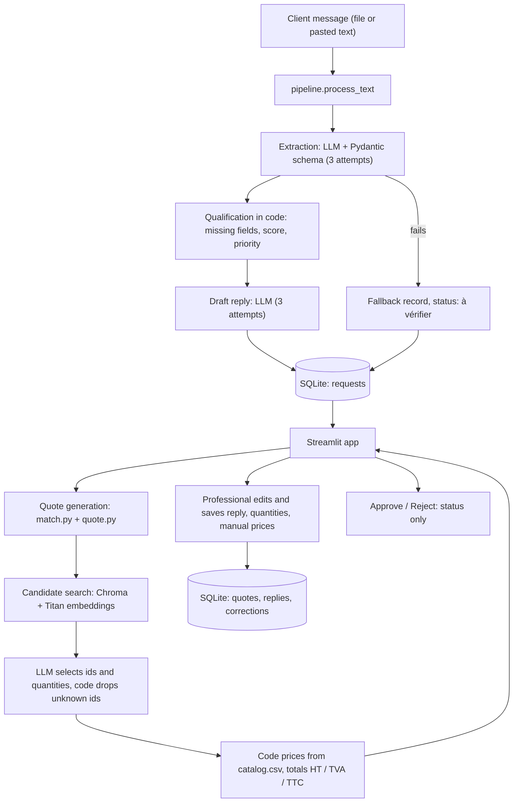

# Architecture

This document explains how the quote request agent is built: the flows, the modules, the data, and the design principle behind them.

## Design principle

**The LLM handles language, the code handles decisions and money.**

- The LLM reads and writes text: it extracts fields from a message, drafts a reply, picks catalog services among a short list, and answers questions about the general conditions.
- The code decides everything that matters: which fields are missing, the score and priority, which ids are valid, every price and total, every status.
- A human validates before anything leaves the system. There is no sending code.

## Overview

There are three flows:

1. **Ingestion** (`pipeline.py`): a message becomes a stored request with a record, a draft reply, a status, a score and a priority.
2. **Quote** (`app.py`, on demand): the professional clicks "Générer le devis brouillon". The service selection and the pricing run, then the professional edits and saves.
3. **General conditions** (`conditions.py`, sidebar): a question is answered from the retrieved articles of the PDF.

## Flow 1: ingestion

1. `process_text(source_name, text)` refuses an empty message.
2. The extraction chain (`extract.py`) returns a `QuoteRequest`: name, email, phone, site address, work types, description, surface in m², urgency, availability, and a flag `is_quote_request`. It is retried up to 3 times.
3. If all attempts fail, a fallback record is stored with the status "à vérifier". Its description is the start of the message, so the request can still be handled by hand.
4. `compute_missing` lists the missing fields: name, phone, email, site address and availability are always required, and the work type must be known. Painting and renovation also require a surface.
5. `qualify.py` computes the completeness score and the priority:
   - the score is the share of the 6 base checks (the 5 required fields and the work type) that are present, lowered further by a missing surface;
   - the priority is "haute" for an urgent request, "moyenne" for a score of at least 70, "basse" otherwise, and "aucune" if the message is not a quote request.
6. A French draft reply is generated (3 attempts). If it cannot be generated, the request is stored without a reply and the professional writes it by hand.
7. The status is set: "hors demande", "à compléter" or "en cours de traitement". The request is saved. If the request already exists, the status is refreshed unless it is "validé" or "rejeté", which are human decisions and are kept.

## Flow 2: quote

1. `match.find_candidates` embeds the request description and searches Chroma for the 8 closest catalog services (filter `doc_type = catalog`).
2. One LLM call returns a `Selection`: a list of catalog ids with an optional quantity and a short reason, plus the work that has no matching service (`unmatched_work`). The prompt forbids selecting damage or consequences, extra preparation, or services for a request that names no specific work.
3. The code drops any id that is not among the candidates.
4. `quote.quote_from_selection` builds the quote lines. Each price and VAT rate comes from the catalog item, never from the LLM. A line without a quantity has no total and is marked "à compléter par le professionnel". Unmatched work becomes a line with no price.
5. `quote.build_quote` computes the totals in code, with VAT calculated line by line. A quote is `complete` only if every line is priced.
6. In the app, the professional types quantities (`set_quantity`) and can price a line outside the catalog by hand (`set_manual_price`). That line is flagged as a manual price. Totals are recomputed each time.
7. "Enregistrer le devis" stores the quote. The generated version is kept separately, so the difference between the generated and the final quote can be logged as a correction. `quote_html.py` produces a downloadable HTML draft with a "BROUILLON" banner.

## Flow 3: general conditions (RAG)

1. `ingest.py` splits `Conditions_generales.pdf` by article (one chunk per article, with `article_number` and `article_title`) and adds the 21 catalog entries. Everything is embedded with Titan and stored in Chroma.
2. `conditions.find_conditions` retrieves the 3 closest articles (filter `doc_type = conditions`).
3. `answer_from_articles` asks the LLM to answer in a short paragraph using only those articles, citing the article numbers. If the articles do not answer, it must say so. It never gives a price or a commitment.
4. The sidebar shows the answer, labelled as indicative, with the source articles.

## Modules

| Module | Responsibility | Uses the LLM |
|---|---|---|
| `schema.py` | `QuoteRequest` model, cleaning of empty values | no |
| `extract.py` | extraction chain, required fields, missing fields, questions | yes |
| `qualify.py` | completeness score, priority | no |
| `reply.py` | French draft reply | yes |
| `catalog.py` | loads the catalog and its prices | no |
| `ingest.py` | builds the vector store | no (embeddings only) |
| `match.py` | candidate search, service selection | yes |
| `quote.py` | quote lines, totals, quantities, manual prices | no |
| `quote_html.py` | HTML draft quote | no |
| `conditions.py` | article retrieval, grounded answers | yes |
| `database.py` | SQLite storage | no |
| `pipeline.py` | orchestration of flow 1, retries, fallback | calls the LLM modules |
| `app.py` | Streamlit interface | calls the modules above |

## Data

### SQLite (`data/agent.db`)

| Table | Key | Content |
|---|---|---|
| `requests` | `id`, `source_file` (unique) | raw text, extracted record (JSON), draft reply, status, score, priority, creation date |
| `quotes` | `source_file` | the saved quote (JSON) with the quantities and prices typed by the professional |
| `generated_quotes` | `source_file` | the quote as generated, kept to compare with the final one |
| `replies` | `source_file` | the reply as edited by the professional |
| `corrections` | `source_file` + `kind` | original and final text of a reply or a quote; removed when the final equals the original |

Quotes, replies and corrections are keyed by `source_file`, not by the request id, so they survive a re-run of the pipeline.

### Chroma (`data/chroma`)

- 13 chunks of the general conditions: `doc_type = conditions`, `article_number`, `article_title`.
- 21 catalog entries: `doc_type = catalog`, `item_id`. The text contains the service name, category, unit and conditions, but **no price**.

The directory is deleted and rebuilt each time `ingest.py` runs.

### Statuses

| Status | Set by | Meaning |
|---|---|---|
| en cours de traitement | pipeline | quote request with all required information |
| à compléter | pipeline | quote request with missing information |
| hors demande | pipeline | not a quote request |
| à vérifier | pipeline | automatic extraction failed, handle by hand |
| validé | professional | approved (status only, nothing is sent) |
| rejeté | professional | rejected |

## Error handling

- Empty message: refused with an explicit error.
- Extraction failure: 3 attempts, then the fallback record and the status "à vérifier".
- Reply failure: 3 attempts, then no reply is stored and the app shows an empty box to write one.
- Unknown service id from the LLM: dropped by code.
- Line without a catalog price: refused by `set_quantity`, and can only be priced through `set_manual_price`, which flags it.

## Configuration and external services

- `.env`: `AWS_REGION`, `EMBED_REGION`, `LLM_MODEL_ID`, `EMBED_MODEL_ID`.
- Amazon Bedrock: `apac.amazon.nova-pro-v1:0` for generation, `amazon.titan-embed-text-v2:0` for embeddings.
- Everything else runs locally: Chroma, SQLite, Streamlit.

## Extension points

- **LangGraph:** the pipeline steps (extraction, qualification, reply, storage) could become the nodes of a graph, with a pause for human validation.
- **LangSmith:** tracing of every LLM call, to inspect prompts and answers.
- **Intake:** a mailbox or web-form connection would call `process_text` instead of the "Nouvelle demande" box.